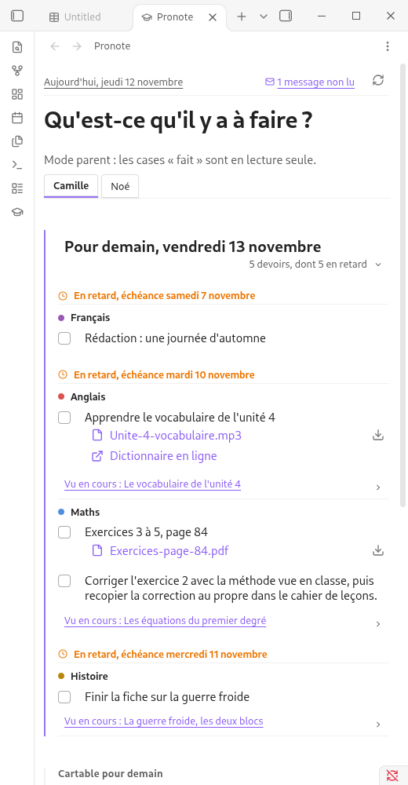
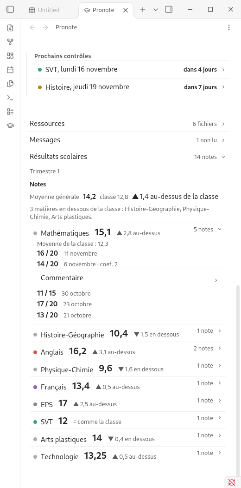
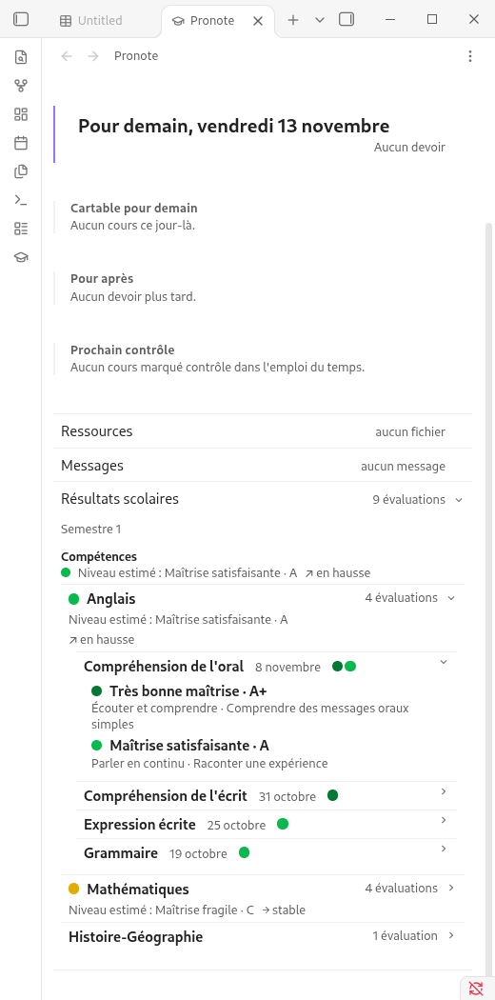

# Pronote Dashboard

**Plugin non officiel**, sans lien avec Index Éducation, l'éditeur de Pronote. « Pronote » est une marque de son propriétaire.

*In English: an unofficial Obsidian plugin that shows a Pronote (French school platform) student's homework, class log, grades and skills assessments in a dashboard, and can sync lessons to Markdown notes. It needs a Pronote account (parent or student) and connects to your school's Pronote server through a QR code. No telemetry. Interface and documentation are in French.*

Tableau de bord Pronote dans Obsidian : devoirs, emploi du temps, cahier de texte, ressources, messages, notes et évaluations par compétences, pour un élève ou pour plusieurs enfants (compte parent). Les séances peuvent aussi être écrites en notes Markdown dans le coffre.



## Ce que fait le plugin

- **Devoirs** regroupés par jour et par matière, « pour demain » (le prochain jour avec cours), devoirs en retard conservés pendant un délai réglable, case « fait » en mode Enfant.
- **Cartable pour demain**, rappels par matière (par exemple « Pense à ton sac de sport »), prochains contrôles.
- **Ressources** : pièces jointes à ouvrir dans Obsidian ou à enregistrer dans le coffre.
- **Messages** : discussions, avec le nombre de messages non lus. Les lire n'est jamais fait en arrière-plan : un message n'est marqué comme lu que lorsque vous l'ouvrez.
- **Résultats scolaires** : notes par matière et évaluations par compétences (voir plus bas).
- **Un onglet par enfant** en mode Parent, y compris pour un compte qui donne accès à plusieurs élèves.
- **Hors ligne** : les dernières données lues restent affichées, conservées sur l'appareil.
- **Synchronisation vers le coffre** (optionnelle) : une note par séance, `Devoirs.md`, `Notes.md` et les pièces jointes.

### Notes

Chaque matière se déplie : moyenne de l'élève, écart à la classe écrit en toutes lettres (« 2,8 au-dessus »), puis les notes avec leur total (sur 5, 10, 20…), leur coefficient, et le commentaire de l'enseignant sur demande. Une ligne signale les matières en dessous de la moyenne de la classe.



### Compétences

Pour les établissements qui évaluent par compétences : pliées par matière, puis par évaluation. Une évaluation repliée montre ses pastilles à la suite sur sa ligne.

| Niveau | Pastille |
| --- | --- |
| A+ | vert foncé |
| A | vert |
| C | jaune |
| E | rouge |

Le niveau est toujours écrit en toutes lettres à côté de la pastille. « Absent » et « Non évalué » n'ont pas de couleur.



**Niveau estimé et tendance.** Pronote ne fournit pas de comparaison à la classe pour les compétences. Le plugin calcule donc lui-même, à titre indicatif, un **niveau estimé** (moyenne des niveaux : A+ = 4, A = 3, C = 2, E = 1) et une **tendance** (les 3 évaluations les plus récentes comparées aux précédentes). Ce calcul n'est pas celui de Pronote ; il est annoncé « estimé » dans l'interface.

## Prérequis

- Un compte Pronote : espace élève, ou espace parent (un espace par établissement).
- Obsidian 1.13.0 ou plus, sur ordinateur ou sur mobile.
- Une connexion à Internet pour actualiser (les données déjà lues restent consultables hors ligne).

## Installation

**Depuis les modules communautaires** (une fois le plugin publié) : Réglages, Modules communautaires, Parcourir, chercher « Pronote », installer puis activer.

**À la main**, depuis la page des [Releases](../../releases) :

1. Télécharger `pronote-dashboard-X.Y.Z.zip`.
2. Le décompresser dans `<coffre>/.obsidian/plugins/` : il crée le dossier `pronote-dashboard/` avec `main.js`, `manifest.json` et `styles.css`.
3. Dans Obsidian : Réglages, Modules communautaires, désactiver le mode restreint si besoin, actualiser la liste, activer **Pronote Dashboard**.

Mise à jour : décompresser la nouvelle archive au même endroit, en remplaçant les fichiers. Les connexions existantes sont reprises (compte élève vers le mode Enfant, comptes parent vers le mode Parent).

## Connexion avec le QR code

À faire pour chaque enfant (ou une fois pour le compte de l'enfant en mode Enfant).

1. Se connecter à Pronote en web, par le site de l'établissement ou l'ENT.
2. Ouvrir Mon compte, puis Application mobile, générer le QR code et choisir un code PIN à 4 chiffres.
3. Faire une capture d'écran du QR code.
4. Dans les réglages du plugin, importer l'image : Ctrl+V sur la page, glisser-déposer, « Choisir un fichier » ou « Image du coffre ».
5. Saisir le code PIN, puis « Se connecter ».

Le QR code et le PIN ne servent qu'une fois : un jeton est ensuite conservé par le plugin. Chaque connexion a son propre QR code.

## Utilisation

- Icône de chapeau de diplômé dans la barre latérale, ou commande **Ouvrir l'écran dans la fenêtre principale** : ouvre le tableau de bord dans un onglet. **Ouvrir dans la barre latérale** l'ouvre en panneau.
- **Synchroniser les séances, devoirs et notes dans le coffre** : écrit les notes Markdown. En mode Parent, tous les enfants connectés sont synchronisés.
- **Basculer entre le mode Enfant et le mode Parent** : si les deux sont connectés.
- Bouton d'actualisation en haut de l'écran : au plus un appui toutes les 2 minutes.

Aucun raccourci clavier n'est défini par défaut : vous pouvez en attribuer dans les réglages d'Obsidian.

### Actualisation automatique

Toutes les 30 minutes par défaut (jamais, 15 min, 30 min, 1 h ou 2 h), seulement Obsidian ouvert, jamais en arrière-plan sur mobile. Une seule connexion Pronote par onglet d'enfant, jamais deux comptes en parallèle ; l'automatique s'arrête après 3 échecs de suite. Une notification dans Obsidian signale un nouveau devoir ou un nouveau message (réglable). Ces limites évitent de solliciter Pronote plus que nécessaire.

## Réglages

- **Mode** Enfant ou Parent, et **sections affichées** pour chaque mode : devoirs, cahier de texte, résultats scolaires, ressources, messages.
- **Devoirs en retard : conservés** 0, 1, 3 ou 7 jours (7 par défaut) après l'échéance, puis ils disparaissent de l'écran.
- **Actualisation automatique**, notification de nouveauté.
- **Cache** : durée de conservation du texte (jours) et plafond des fichiers (0 à 200 Mo), bouton « Vider le cache ».
- **Rappels** par matière, **dossier de synchronisation**, **propriétés des notes de séance** (YAML, avec les variables `{{matiere}}`, `{{eleve}}`, `{{date}}`, `{{professeur}}`).

## Synchronisation vers le coffre

```
Pronote/                       (mode Enfant) ou Pronote/<Prénom>/ (mode Parent)
  Devoirs.md
  Notes.md
  Séances/<Matière>/2026-11-05 Mathématiques.md
  Pièces jointes/<Matière>/2026-11-05 Fractions.pdf
```

Les notes de séance déjà créées ne sont jamais réécrites : vous pouvez les annoter. `Devoirs.md` et `Notes.md` sont régénérées à chaque synchronisation. Chaque note de séance porte des propriétés typées (`type`, `statut`, `date`, `matiere`, `professeur`, `eleve`, `devoir_pour`, `tags`, `pronote_id`). Vous pouvez ranger les fichiers où vous voulez : les notes sont retrouvées par `pronote_id`, et les renommages sont suivis.

## Confidentialité et divulgations

- **Compte requis** : le plugin ne fonctionne qu'avec un compte Pronote (élève ou parent).
- **Réseau** : le plugin contacte uniquement **le serveur Pronote de votre établissement**, par la bibliothèque non officielle [Pawnote-LTS](https://github.com/BlocksHub/Pawnote-LTS), embarquée dans le plugin, pour lire vos données. Aucun autre service, aucun serveur du projet.
- **Aucune télémétrie** : rien n'est envoyé à l'auteur ni à un tiers.
- **Écritures vers Pronote** : seulement cocher « fait » un devoir (mode Enfant) et ouvrir un message, ce qui le marque comme lu. Le mode Parent ne coche rien.
- **Données d'enfants** : les noms, notes et devoirs restent sur votre appareil et dans votre coffre. Ne synchronisez pas votre coffre vers un service public.
- **Jeton de connexion** : conservé **en clair** dans `.obsidian/plugins/pronote-dashboard/data.json`. Ne partagez pas ce fichier et ne le versionnez pas.
- **Cache** : stocké dans la base IndexedDB de l'appareil (non synchronisée), durée et volume réglables, effaçable à tout moment.
- **Fichiers hors du coffre** : le plugin n'y accède pas.

## Limites connues

- Pronote n'a pas d'API officielle. La bibliothèque non officielle peut cesser de fonctionner après une mise à jour de Pronote.
- Pas de comparaison à la classe pour les compétences (la donnée n'est pas fournie) ; le niveau estimé est une estimation.
- La photo de l'élève n'est pas affichée (l'adresse fournie par la bibliothèque ne répond pas).
- Les liens vers les fichiers de Pronote expirent avec la session : les fichiers sont copiés dans le coffre à l'enregistrement ou à la synchronisation.

## Contribuer

Voir [CONTRIBUTING.md](CONTRIBUTING.md). Les agents de développement lisent d'abord [AGENTS.md](AGENTS.md). Les décisions de conception sont dans [`docs/adr/`](docs/adr/README.md), le vocabulaire dans [`CONTEXT.md`](CONTEXT.md), les failles se signalent selon [`docs/SECURITY.md`](docs/SECURITY.md).

## Crédits et licence

Copyright (C) 2026 Freeflod. Logiciel libre, distribué sous **GNU GPL version 3 ou ultérieure** (fichier [`LICENSE`](LICENSE)).

Les licences complètes de tous les composants embarqués sont dans [`THIRD_PARTY_NOTICES.md`](THIRD_PARTY_NOTICES.md).

Composants embarqués : [Pawnote-LTS](https://github.com/BlocksHub/Pawnote-LTS) (GPL-3.0), fork maintenu de Pawnote ; [jsQR](https://github.com/cozmo/jsQR) (Apache-2.0), pour lire le QR code.
